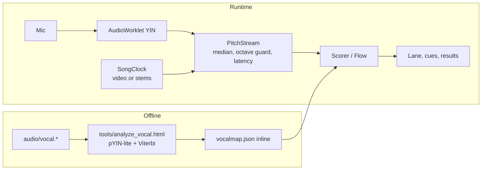

# intelliCARE Music Sing-a-Long · 城里的月光 | Moonlight in the City

*Performed by Alyssa Lie · Ep 03 "Pitch Accuracy and Melody Flow" / 音准与旋律流畅度.*
Cover of 《城里的月光》, original by 许美静 Mavis Hee, words & music 陈佳明 Chen Jiaming (1995). Confirm that the performance and lyric licences cover public web use before deployment.

> **Status: alpha 1.** The core app, offline analyser and tests are done and verified. The Sheets backend, dashboards, Vocal-Map Editor, Colab notebook, QR code and a few extras are **not built yet**. See [§12 Status and open items](#12-status-and-open-items). Until the real stems are analysed, the app runs on a clearly labelled **synthetic demo map** that does not match the real song.

## 1. About this session

> In this reflective and melodic session, Alyssa performs the beloved Singaporean Mandarin classic 《城里的月光》, guiding seniors through the essentials of pitch accuracy and smooth melodic flow. She demonstrates how to navigate Mandarin pronunciation while staying in tune and connecting emotionally with the music. Through breakdowns and a guided sing-along, participants learn to maintain pitch stability and perform the melody with confidence and elegance.

A draft Simplified-Chinese translation is in `Config.ABOUT_ZH` (marked `TODO(Aaron): review`).

## 2. Run it

* Local: serve the folder over HTTP(S) (`localhost` counts as secure) and open `index.html`. The microphone needs HTTPS or localhost.
* GitHub Pages: push the repo as `intellicare-singalong-alyssa01`, enable Pages on the root. `.nojekyll` is included.
* `?test=1` runs the unit tests. `?debug=1` shows the clock/detector overlay. `?demo=1` forces Demo/Stage mic mode.
* Windows tooling: `tools\run_tests.ps1`, `tools\shots.ps1`, `tools\run_analyze_vocal.ps1`. Use `powershell -ExecutionPolicy Bypass -File …` if script execution is blocked.

## 3. What the user sees

A video, then a **scrolling pitch lane** under it (the lane is a separate panel, nothing is drawn over the video). Alyssa's melody is drawn as note bars and a thin contour. The singer's voice is a glowing line, coloured green / cyan / amber / red by error (≤25 / ≤50 / ≤100 / >100 ¢) and thicker when more accurate. The line is octave-folded, so men, children and seniors can sing in their own octave (an "8va" badge shows when it is folded).

Live cues: tuner needle, "▲ Sing higher / ▼ Sing lower" with cents, PERFECT / GREAT / GOOD / MISS with EARLY/LATE, "Hold it", "Breathe", "Louder", "Steady!", "Nice vibrato!", and the Melody Flow cues "Connect the notes / 连起来唱", "Glide smoothly / 滑顺一点", "Lovely flow! / 很流畅！" (all bilingual).

Modes: **Sing** (ranked), **Practice** (phrase A–B loop, 0.75/0.9/1× speed, guide tone), **Duet / Pass the Mic**, **Watch & Learn** (no mic), **Warm-up** (scale, siren, sustained "ah", lip-trill timing), **Vocal Tests** (Range Finder, Pitch Match, Breath Power). All tests are labelled *for fun and engagement, not a medical, clinical or vocal-health assessment*.

## 4. Architecture



Single `index.html` (vanilla JS, worklet inlined via a Blob URL). No build step.

## 5. Science and algorithms

### 5.1 Singing accuracy
Karaoke-style evaluation compares a singer with a reference on pitch, loudness and rhythm (Tsai & Lee, 2012). Singing accuracy research uses cents error to a target (Pfordresher & Brown, 2007; Demorest & Pfordresher, 2015). The weights in §6 are **heuristic and not a validated psychometric scale**.

### 5.2 Pitch detection (YIN)
Per 10 ms hop the worklet analyses the last 2048 samples, decimated by $D=\mathrm{round}(f_s/22050)$ (so ≈24 kHz at 48 kHz). With window $W=n/2$:

$$d(\tau)=\sum_{j=0}^{W-1}(x_j-x_{j+\tau})^2,\qquad d'(\tau)=\frac{d(\tau)}{\frac1\tau\sum_{k=1}^{\tau}d(k)}$$

The first $\tau$ with $d'(\tau)<0.15$ (then descend to the local minimum) is refined by parabolic interpolation; $f_0=f_s/\tau^*$ and clarity $=1-d'(\tau)$ (de Cheveigné & Kawahara, 2002). Search range 60–1200 Hz. A frame is **voiced** when clarity ≥ 0.80 **and** RMS ≥ noise floor + 10 dB. Cents: $c=1200\log_2(f/440)+6900$ (MIDI × 100).
Main thread: centred 5-frame median, octave-jump guard (>900 ¢ jump needs 6 frames to be accepted), 10 ms hold-over across a single unvoiced frame. Tests show ≤ 2 ¢ error on sine tones at 110/220/440/880 Hz (44.1 and 48 kHz).

### 5.3 Reference melody (offline pYIN-lite)
`tools/analyze_vocal.html` evaluates $d'$ at thresholds 0.05…0.50 weighted by a Beta(2,18) density, accumulates probabilities into 20-cent bins (C2–C6) plus an unvoiced state, and decodes with Viterbi (Gaussian jump penalty, σ = 2 bins; voiced↔unvoiced switch 0.01), following Mauch & Dixon (2014). Segmentation: median-smooth 7 frames; new note on >80 ¢ departure for ≥50 ms or an unvoiced gap ≥60 ms; minimum 100 ms; merge neighbours <35 ¢ apart and <40 ms; note pitch = median of the middle 60 %. Vibrato on notes ≥400 ms (§5.6). Phrases split at unvoiced gaps ≥350 ms. Golden ("Moon") notes: longest note ≥500 ms per phrase, else the highest.

### 5.4 Octave folding
$d=((c_U-c_R+600)\bmod 1200+1200)\bmod1200-600$, giving −600…+600 ¢ (the SingStar convention).

### 5.5 Note scoring
Frames from 80 ms after the note start to its end are scored with
$s(d)=1$ if $|d|\le T_1$, linearly to 0 at $T_3$, else 0; an unvoiced user frame scores 0.

| Difficulty | $T_1$ | $T_3$ | lag search |
|---|---|---|---|
| Gentle (default) | 50 ¢ | 200 ¢ | ±250 ms |
| Normal | 35 ¢ | 150 ¢ | ±150 ms |
| Pro | 20 ¢ | 100 ¢ | ±100 ms |

A lag $\tau\in[-S,S]$ (5 ms steps) maximises the note's pitch score. Because sampling starts 80 ms after the note start, the set of equally good lags for a user delayed by $d$ is $[d-0.08,d]$, so the estimator takes **the centre of that plateau + 40 ms** (the unit test recovers a 120 ms delay to ±15 ms). If the plateau touches the search limit the best lag is used as is.

$$\text{note}=0.80\,\text{pitch}+0.10\,\text{timing}+0.10\,\text{stability}\;(+0.05\text{ vibrato}),\quad \text{timing}=\max(0,1-|\tau|/S)$$

Timing is 0 when no frame was voiced. Stability $=\max(0,1-SD/60)$ for notes ≥400 ms (otherwise equal to pitch); on a vibrato note the SD is also measured about the reference contour and the smaller value is used. Judgement: PERFECT ≥ 0.90, GREAT ≥ 0.75, GOOD ≥ 0.50, else MISS.

Points $=$ base (300/200/100) × clamp(dur/0.4 s, 0.5, 3) × combo multiplier (×1 for 0–4, ×2 for 5–9, ×3 for 10–19, ×4 for 20+ consecutive GOOD-or-better) × golden (×2) × Moonlight Mode (×2). A phrase with every note GREAT or better earns +500. `maxPoints` is the same formula with every note PERFECT (+500 per phrase; Pro adds 200 per phrase for expression).

### 5.6 Vibrato
Detrend with a quadratic fit, autocorrelate over 125–250 ms lags; present when the peak > 0.4, rate 4–8 Hz and extent (P95−P5)/2 in 20–150 ¢. The bonus needs the user rate within ±1.5 Hz and extent within 50 % of the reference (Nakano et al., 2006; Sundberg, 1987).

### 5.7 Expression
Per phrase, Pearson $r$ between the user and reference RMS-dB envelopes (50 ms frames, both voiced, ≥6 pairs), mapped $\max(0,r)$. (Loudness-shape similarity: Tsai & Lee, 2012.)

### 5.8 Singing Score (0–100)

$$S=0.35P+0.15H+0.15F+0.10T+0.10B+0.10E+0.05C$$

$P$ pitch accuracy, $H$ note hit rate (note score ≥ 0.5), $F$ Melody Flow, $T$ timing (notes with pitch ≥ 0.5), $B$ stability (long notes with pitch ≥ 0.5), $E$ expression, $C$ coverage (reference-voiced frames where the user is voiced). Grades S ≥ 90, A ≥ 80, B ≥ 70, C ≥ 60, D below; stars 5/4/3/2/1 at the same cut-offs. Only the `singalong` and `performance` sections count.

### 5.9 Melody Flow (lesson focus)
Legato = smooth, connected singing. For phrase $p$:

* **Continuity** $C_p=1-\frac{\sum\text{unintended gaps}>120\text{ ms}}{|R_p|}$ over reference-voiced frames (so the singer's own breaths are excluded; the 120 ms threshold ignores Mandarin consonant onsets).
* **Transition** $Q_k$ for each legato pair (reference gap < 80 ms): $T_u$ = time from the user's last frame within ±50 ¢ of note a to the first within ±50 ¢ of note b (±300 ms search), $T_r$ the same on the reference, overshoot = excess beyond b in the 200 ms after arrival, scoop = $T_u>T_r+150$ ms.
$$Q_k=1-0.4\min(1,|T_u-T_r|/250)-0.4\min(1,\text{over}/120)-0.2[\text{scoop}],\quad Q_k=0\text{ if the voice breaks}$$
* $\text{Flow}_p=100(0.5C_p+0.5\overline{Q})$ (only $C_p$ without legato transitions); song Flow = voiced-duration-weighted mean. An arc on the lane is lit when $Q_k\ge0.7$.

This is a **heuristic engagement indicator, not validated**.

### 5.10 Lesson structure
`talk` sections (Alyssa speaking) are never scored and never become note bars (speech would produce meaningless "notes"); the lane dims and a "Listen to Alyssa" card appears. `breakdown` sections run call-and-response: her notes are outlined ("Listen"), then the same notes reappear in the echo window ("Your turn") and are scored at Gentle tolerance into a separate Breakdown sub-score, which is not ranked. `singalong` and `performance` are scored and ranked.

### 5.11 Latency, clock and bleed
* Song time of a mic frame $=t_{song}(t_{ctx})-0.0213-\text{inputLatency}-\text{calibration}-\text{autoSync}$ (0.0213 s is half the 2048-sample window at 48 kHz). ctx→performance time uses the minimum of the last 200 arrival offsets.
* Video clock: interpolated from `requestVideoFrameCallback`. Stem mode: `AudioContext` is master, `t_song=t_0+(t_{ctx}-t_{ctx,0}-\text{outputLatency})\cdot\text{rate}`; the video is slaved every 250 ms (rate ±3 % for 30–120 ms drift, seek above 120 ms). Stem mode needs `audio/instrumental.*` (HEAD-detected); speeds < 1× use the video soundtrack.
* "ta" latency calibration: 8 clicks at 90 BPM, onset = first RMS rise > 12 dB in 3 frames, median after rejecting outliers > 200 ms, stored per input device.
* Bleed check (Speakers mode): 6 s passage plays while silent; bleed = share of reference-voiced frames matched within ±100 ¢ (best lag 0–400 ms); > 15 % → unranked.

### 5.12 Demo / Stage mode
Mic signal $m(t)=g\,v(t)+h*s(t-\delta)+n(t)$. A singer in the same octave as Alyssa has the **same pitch** as the leakage, so the gate uses **level**: a frame counts as the singer only if
$$\text{rms}\ge\max(N+10,\ \hat m_i+\max(6,2\sigma_b)+\text{boost}),\quad \hat m_i=\text{mixDb}(t-\hat\delta)+\hat G$$
and clarity ≥ 0.80. Room calibration (quiet 3 s, speakers 8 s, singer 5 s) gives $N$, $\hat\delta$ (cross-correlation over 0–400 ms), $\hat G$ (median residual), $\sigma_b$ (MAD×1.4826), $B_{95}$, $U$ and headroom $H=U-B_{95}$: ≥ 12 dB ranked, 6–12 dB usable/unranked, < 6 dB poor. The calibration is stored per (input, output) pair.
**Watchdog (deviation from the written spec):** the spec's trigger (accepted frames within ±3 dB of the *predicted bleed*) can never occur because accepted frames are by definition ≥ 6 dB above it. The code fires when ≥ 90 % of 200 consecutive accepted frames are within 3 dB of the *gate threshold* and within ±30 ¢ of the reference; it then adds +3 dB to the margin (max +12 dB). Three triggers make the run unranked.
**Auto-sync:** after 12 notes with pitch ≥ 0.6, offset = median lag (±350 ms); afterwards `offset += 0.2 × median(residual lags of the phrase)` (the spec's smoothing formula would converge to 0 because lags are measured on the corrected timeline).
The microphone connects only to the analysis worklet (0 outputs). In Demo mode the monitor, guide tone, tap-to-hear and tone targets are disabled, and a "🔇 Singer not amplified" chip shows. If the vocal map has no `mixDb`, the gate falls back to a static threshold $B_{95}$ + margin.

### 5.13 Vocal tests
* **Range Finder:** two 10 s rounds; sustained notes = segments within ±60 ¢ of their running median for ≥ 1 s; lowest of round 1, highest of round 2.
* **Pitch Match:** 10 trials, target within the saved range, median folded error over 0.5–1.5 s of a 2 s window.
* **Breath Power (MPT):** longest voiced run (gaps < 150 ms bridged, RMS ≥ floor + 8 dB); 3 trials, best kept. MPT is a common simple measure of phonation; older-adult values are reported by Maslan et al. (2011). *Stop if dizzy; seniors stay seated.*

## 6. Privacy
Audio never leaves the device. No recording is made. Only numeric metrics are sent, and only with the profile's remote-sharing consent (PDPA). The mic is disabled on pause and stopped on results. Profiles, XP and achievements live in `localStorage`; song-scoped keys use the `moonlight-in-the-city.` prefix.

## 7. Layout of the repository

```
index.html                 the whole app (CSS, JS, inline vocal map, worklet source)
assets/stage/*.png         hero cut-outs and avatar (supplied)
audio/                     vocal.* (required for the real map), instrumental.* (Stem mode), lyrics.txt, lyrics_pinyin.txt
tools/analyze_vocal.html   offline analyser;  tools/run_analyze_vocal.ps1  headless driver + embed
tools/run_tests.ps1        runs ?test=1;  tools/shots.ps1  4-viewport screenshots;  tools/cdp_run.ps1  CDP helper
tools/README.md            step-by-step guide, backend contract
```

## 8. Vocal map schema (`<script id="vocalmap">`)
`{version, song:{id,duration}, offsetMs, hopMs:10, f0:b64 Int16LE cents (−1 = unvoiced), rms:b64 Int8 (dB+100, 50 ms), mixDb:b64 Int8|null, key, range, notes:[{t0,t1,c,gold,vib:{rate,extent}|null,phrase}], phrases:[{t0,t1,text,pinyin,words:[{t,w,py}]}], sections:[{t0,t1,type,name,tip:{en,zh},echo:[{t0,t1,notes:[idx]}]}], transitions (optional; derived at load), meta}`. Difficulty note sets and `maxPoints` are derived at load.

## 9. Tests
`?test=1` runs 27 tests: YIN accuracy (±2 ¢), noise/silence, folding, scoring thresholds, perfect/silent/octave-shifted/late/sharp singers, full PitchStream chain, vibrato, expression, MPT, sustained-note finder, Melody Flow (legato high, chopped low, overshoot penalised), echo scoring, bleed score, latency calibration, Demo gate and calibration maths, watchdog, auto-sync, routing guard, worklet self-containment. Result of the last run: **27/27**.

## 10. Limitations
Detector errors on noisy or breathy voices; octave ambiguity (mitigated by folding); AEC can chop sustained notes; Bluetooth call mode degrades latency and bandwidth; mic distance determines Demo headroom; weights and Melody Flow are not validated; not a clinical tool. iOS Safari behaviour of an output-less `AudioWorkletNode` and `audioSession` has **not been tested**.

## 11. References (APA 7)
* de Cheveigné, A., & Kawahara, H. (2002). YIN, a fundamental frequency estimator for speech and music. *The Journal of the Acoustical Society of America, 111*(4), 1917–1930. https://doi.org/10.1121/1.1458024
* Demorest, S. M., & Pfordresher, P. Q. (2015). Singing accuracy development from K-adult: A comparative study. *Music Perception, 32*(3), 293–302. https://doi.org/10.1525/mp.2015.32.3.293
* Mauch, M., & Dixon, S. (2014). pYIN: A fundamental frequency estimator using probabilistic threshold distributions. *ICASSP 2014*, 659–663. https://doi.org/10.1109/ICASSP.2014.6853678 [to verify pages/DOI]
* Maslan, J., Leng, X., Rees, C., Blalock, D., & Butler, S. G. (2011). Maximum phonation time in healthy older adults. *Journal of Voice, 25*(6), 709–713. https://doi.org/10.1016/j.jvoice.2010.10.002
* Nakano, T., Goto, M., & Hiraga, Y. (2006). An automatic singing skill evaluation method for unknown melodies using pitch interval accuracy and vibrato features. *Interspeech 2006*, 1706–1709. [to verify]
* Pfordresher, P. Q., & Brown, S. (2007). Poor-pitch singing in the absence of "tone deafness". *Music Perception, 25*(2), 95–115. https://doi.org/10.1525/mp.2007.25.2.95
* Sundberg, J. (1987). *The science of the singing voice*. Northern Illinois University Press.
* Tsai, W.-H., & Lee, H.-C. (2012). Automatic evaluation of karaoke singing based on pitch, volume, and rhythm features. *IEEE Transactions on Audio, Speech, and Language Processing, 20*(4), 1233–1243. https://doi.org/10.1109/TASL.2011.2174224 [to verify DOI]

## 12. Status and open items

**Done and verified:** pitch worklet + tests; offline analyser (verified on a synthetic stem: 6/6 notes recovered at the exact pitches and times); scorer, Melody Flow, sections, echo windows; Video and Stem playback code; mic check, bleed check, latency and room calibration; lane, tuner, cues; Sing, Practice, Duet, Watch, Warm-up, Vocal Tests; results with radar, replay, histogram, coaching and share card; profiles, XP, achievements, local leaderboards, outbox client; Demo gate, watchdog, auto-sync; 27/27 tests; screenshots at 360×740, 390×844, 1024×768 and 1440×900 with no script errors.

**Not built yet:** Google Apps Script backend and both dashboards (the client already posts `{action:'submit',…}` and reads `{action:'leaderboard',…}`; contract in `tools/README.md`); Vocal-Map Editor (edit sections/echo windows/lyric timing in the JSON by hand for now); Colab notebook (`pypinyin`, Demucs); automatic echo-window detection and stem→video alignment (`offsetMs` is 0); stage extras (QR code, results carousel, "Now singing" banner is only a placeholder element); "Record my take"; norms engine and facilitator view; daily challenges, coins and cosmetics; `mixDb` from the video soundtrack; the tone-singer test runs through the PitchStream, **not** through a live microphone; Stem mode and live-mic behaviour are untested on real devices.

**Needs Aaron:** `audio/vocal.*` (+ instrumental, lyrics, pinyin); Alyssa's Chinese name (optional); review of the 中文 About text; Sheet ID and exec URL.
